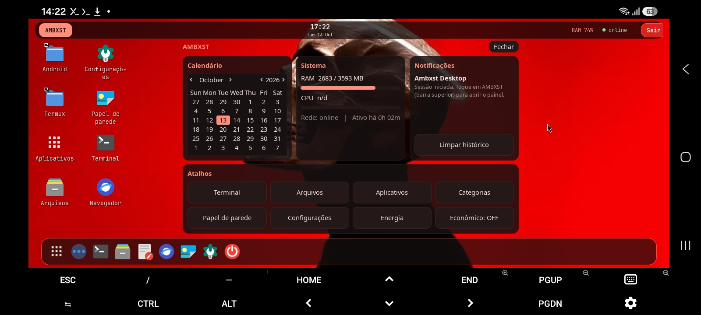

<div align="center">

# Infynit AI

**Um desktop Linux completo no Android — Debian ARM64 no Termux, exibido pelo Termux:X11.**


-a81d33)


<a href="https://trendshift.io/repositories/15362?utm_source=trendshift-badge&amp;utm_medium=badge&amp;utm_campaign=badge-trendshift-15362" target="_blank" rel="noopener noreferrer"></a>
<a href="https://trendshift.io/repositories/15362" target="_blank"></a>

</div>



</div>

Infynit AI instala e configura, com um único comando, um ambiente gráfico leve
(Openbox + tint2 + rofi) dentro de um Debian via `proot-distro`, com visual inspirado no
shell **Infynit AI**: barra superior, painel de controle, dock flutuante, cantos arredondados e
transparência. Não precisa de root e foi desenhado para celulares com 4 GB de RAM.

## Sumário

- [Recursos](#recursos)
- [Requisitos](#requisitos)
- [Início rápido: instalação por npm](#início-rápido-instalação-por-npm)
- [Publicar o seu próprio repositório](#publicar-o-seu-próprio-repositório)
- [Instalação em detalhe](#instalação-em-detalhe)
- [Uso diário](#uso-diário)
- [Interface, toque e atalhos](#interface-toque-e-atalhos)
- [Configuração](#configuração)
- [Papel de parede](#papel-de-parede)
- [Navegador](#navegador)
- [Ferramentas de IA e mídia](#ferramentas-de-ia-e-mídia)
- [Login](#login)
- [Segurança: OSINT, Red Team, Blue Team e Purple Team](#segurança-osint-red-team-blue-team-e-purple-team)
- [ISO para PC](#iso-para-pc)
- [Integração com TwinDesk](#integração-com-twindesk)
- [Modo econômico](#modo-econômico)
- [Atualização](#atualização)
- [Solução de problemas](#solução-de-problemas)
- [Arquitetura e estrutura do projeto](#arquitetura-e-estrutura-do-projeto)
- [Desinstalação](#desinstalação)
- [Limitações conhecidas](#limitações-conhecidas)
- [Segurança](#segurança)
- [Licença e créditos](#licença-e-créditos)

## Recursos

| Área | O que você tem |
|---|---|
| **Barra superior** | Botão **AMBXST** (abre o painel), relógio, uso de RAM, indicador de conexão, bandeja do sistema e botão **Sair** |
| **Painel Infynit AI** | Calendário, RAM/CPU/rede/volume, histórico de notificações e atalhos (terminal, arquivos, apps, categorias, papel de parede, configurações, energia, modo econômico) |
| **Dock** | Menu Iniciar, categorias, terminal, arquivos, editor, Firefox, Brave, lixeira, papel de parede, configurações, energia e a lista de janelas abertas |
| **Login** | Pede para criar uma conta (usuário + senha) na 1ª vez e a senha nas próximas, antes do desktop carregar |
| **Ferramentas** | Botões **Claude Code**, **OpenCode**, **Shannon**, **GitBot** e **Filmes, Séries e Animes**: o 1º toque instala, os seguintes abrem |
| **Segurança** | Botões **OSINT**, **Red Team**, **Blue Team** e **Purple Team**: cada um abre uma lista de ferramentas que instalam e abrem sozinhas |
| **Menu de aplicativos** | Busca e categorias (rofi), pensado para toque |
| **Área de trabalho** | Papel de parede, ícones que abrem os aplicativos e atalhos para as pastas **Android** e **Termux** |
| **Arquivos e lixeira** | pcmanfm com acesso ao armazenamento do Android (autorizado) e à home do Termux; excluir move para a **lixeira**, que pode ser aberta ou esvaziada pelo ícone |
| **Visual** | Tema preto/vermelho com destaque salmão, Papirus-Dark, JetBrains Mono, janelas arredondadas e translúcidas (picom) |
| **Sessão** | `ambxst-start/stop/restart/status/fix/logs`, reinício da sessão gráfica pelo menu de energia |
| **Leve** | Sem serviços desnecessários, sem aceleração obrigatória, modo econômico de memória |

## Requisitos

- Android com **ARM64 (aarch64)** e ~3 GB livres.
- **Termux** (F-Droid ou GitHub — não a versão da Play Store).
- App **Termux:X11** (APK *nightly* do repositório `termux/termux-x11`). O pacote
  `termux-x11-nightly` instalado pelo script e o APK devem ser da mesma linhagem *nightly*.
- Internet durante a instalação (~1 GB de download).
- Recomendado: 4 GB de RAM ou mais.

## Início rápido: instalação por npm

Todos os comandos desta seção rodam no **Termux**.

```bash
pkg update -y && pkg install -y nodejs     # só o Node.js é necessário
npx infynit-ai install --start             # instala tudo e já inicia o desktop
```

Pronto: o desktop aparece no app **Termux:X11** (aceite o pedido de acesso ao armazenamento
quando o Android perguntar). Para sair, use `infynit-ai stop` ou **Sair → Encerrar sessão** na
barra superior.

Prefere deixar o comando instalado? `npm install -g infynit-ai` e depois `infynit-ai install`.

```bash
infynit-ai install --twindesk     # (opcional) também copia o APK do TwinDesk
infynit-ai install --brave        # (opcional) também instala o Brave (~500 MB)
infynit-ai start | stop | restart | status | fix | logs
infynit-ai update                 # baixa a versão nova do pacote e reaplica a instalação
```

`infynit-ai <comando>` é um atalho para os comandos `ambxst-*` (ex.: `infynit-ai start` =
`ambxst-start`); os dois funcionam depois de instalado.

> Alternativas sem npm: `git clone https://github.com/stylesxzz/Infynit-AI.git && cd Infynit-AI && bash install-ambxst.sh`,
> ou direto do GitHub: `npm install -g github:stylesxzz/Infynit-AI`.

## Publicar o seu próprio repositório

Para versionar e publicar este projeto (a partir da pasta do projeto, no Termux):

```bash
git config --global user.name  "Seu Nome"
git config --global user.email "voce@exemplo.com"

git init -b main
git add .
git commit -m "Infynit AI: versão inicial"

# Crie um repositório vazio no GitHub e copie a URL dele:
git remote add origin https://github.com/<seu-usuario>/ambxst-desktop-termux.git
git push -u origin main
```

No GitHub, a senha da conta não funciona no `git push`: use um *Personal Access Token*
(ou `gh auth login`, se instalar o GitHub CLI com `pkg install gh`).
O arquivo `.gitattributes` mantém os scripts com final de linha LF, necessário no Termux.

> **Imagens:** `docs/reference-ui.jpg` é uma captura do shell Infynit AI original;
> `debian/skel/wallpapers/skull.jpg` e `debian/skel/wallpapers/infynit.jpg` (papel de parede
> padrão) e `debian/skel/icons/login-avatar.jpg` (avatar do login) não foram criadas por este
> projeto. Remova ou troque essas imagens antes de tornar o repositório público, se não tiver
> direito de redistribuí-las.

### Publicar no npm

Para que `npx infynit-ai install` funcione para qualquer pessoa, publique o pacote uma vez
(o nome `infynit-ai` precisa estar livre; senão use um escopo, ex.: `@seu-usuario/infynit-ai`,
e troque o `name` no `package.json`):

```bash
npm login
npm publish --access public
```

Para lançar uma versão nova: aumente o `version` no `package.json` e rode `npm publish` de novo.

## Instalação em detalhe

`install-ambxst.sh` é **idempotente**: pode ser executado de novo sem destruir nada.

| Etapa | O que acontece | Onde roda |
|---|---|---|
| 1 | Detecta se está no Termux e se não é root | Termux |
| 2 | Verifica a arquitetura (ARM64) e o espaço livre | Termux |
| 3 | Instala `proot-distro`, `termux-x11-nightly`, `pulseaudio` e utilitários | Termux |
| 4 | Confere os comandos necessários e se o app Termux:X11 está instalado | Termux |
| 5 | Pede acesso ao armazenamento compartilhado (`termux-setup-storage`) | Termux |
| 6 | Instala os comandos `ambxst-*` em `$PREFIX/bin` e o projeto em `~/.ambxst` | Termux |
| 7 | Instala o Debian ARM64 via `proot-distro` (reaproveita se já existir) | Termux |
| 8 | Instala pacotes e aplica temas/configurações (`debian/setup-debian.sh`) | **Debian** (como root) |
| 9 | Verificação final de arquivos e aplicativos | Termux/Debian |

Opções: `--browser` (Firefox), `--brave` (Brave), `--twindesk`, `--skip-storage`, `--restore-config`
(recoloca as configurações padrão, com backup `.bak-DATA`). Log: `~/.ambxst/logs/install.log`.

## Uso diário

| Comando (Termux) | Função |
|---|---|
| `ambxst-start` | Inicia o servidor Termux:X11 e a sessão Debian; abre o app |
| `ambxst-stop` | Encerra a sessão com segurança |
| `ambxst-restart` | Reinicia tudo |
| `ambxst-status` | Mostra o que está rodando |
| `ambxst-fix` | Diagnostica tela preta/erros e corrige o que é seguro |
| `ambxst-logs` | Logs: `x11`, `proot`, `session`, `panel`, `autostart`, `wallpaper` (`-f` segue, `-n 100` mais linhas) |
| `ambxst-eco on\|off` | Modo econômico (depois: `ambxst-restart`) |
| `ambxst-browser-install [firefox\|brave\|all]` | Instala Firefox ESR e/ou Brave no Debian |
| `ambxst-twindesk status` | Verifica a integração com TwinDesk e explica o pareamento com o PC |
| `ambxst-twindesk install` | Abre o instalador do APK TwinDesk no Android |

Dica: **primeiro** `ambxst-start`, **depois** olhe o app Termux:X11.

## Interface, toque e atalhos

- **Toque:** um toque aceita itens dos menus; o comportamento de clique direito e rolagem
  depende do modo de entrada em *Preferences* do Termux:X11 (touchpad/touchscreen simulado).
- **Teclas especiais:** ative *Show additional keyboard* nas preferências do Termux:X11 para
  Ctrl, Alt, Tab e Esc. Teclado e mouse Bluetooth funcionam normalmente.
- **Atalhos de teclado:**

| Atalho | Ação |
|---|---|
| `Super + Espaço` | Menu Iniciar (busca de aplicativos) |
| `Super + C` | Categorias de aplicativos |
| `Super + E` | Gerenciador de arquivos |
| `Super + P` | Painel Infynit AI |
| `Ctrl + Alt + T` | Terminal |
| `Alt + Tab` | Alternar janelas |
| `Alt + F4` | Fechar janela |
| `Super + D` | Mostrar a área de trabalho |

- **Resolução e orientação:** defina em *Preferences → Display* do app Termux:X11
  (por exemplo 1280×720 em paisagem) e rode `ambxst-restart`. O DPI vem de `AMBXST_DPI`.

## Configuração

Arquivo: `~/.config/ambxst/ambxst.conf` **dentro do Debian**
(no Termux: `$PREFIX/var/lib/proot-distro/containers/debian/home/ambxst/.config/ambxst/ambxst.conf`,
ou edite pelo menu **Configurações → Editar configuração do Infynit AI**).

| Chave | Padrão | Descrição |
|---|---|---|
| `AMBXST_ECO` | `0` | `1` liga o modo econômico |
| `AMBXST_DPI` | `120` | DPI do servidor Termux:X11 (maior = interface maior) |
| `AMBXST_X11_ARGS` | `-ac` | Argumentos extras do `termux-x11` |
| `AMBXST_AUDIO` | `1` | Inicia o PulseAudio (somente `127.0.0.1`) |
| `AMBXST_PICOM` | `1` | Compositor (cantos arredondados/transparência); se falhar, o desktop segue sem efeitos |

## Papel de parede

- Dock ou desktop → **Papel de parede**: escolha na lista ou use *Procurar outro arquivo…*
- Copie imagens para `~/Pictures/Wallpapers/` (Debian) e elas aparecem na lista.
- Linha de comando (dentro do Debian): `ambxst-wallpaper /caminho/imagem.jpg`
- O papel de parede inicial tem 736×414 px; use uma imagem maior para ficar nítido.

## Navegadores

```bash
ambxst-browser-install            # Firefox ESR (~250 MB)
ambxst-browser-install brave      # Brave, do repositório oficial arm64 (~500 MB)
ambxst-browser-install all        # os dois
```

Os ícones **Navegador** (Firefox) e **Brave** ficam sempre na dock; sem o navegador instalado,
o clique avisa como instalar. Dentro do proot os navegadores precisam de flags especiais, que
os lançadores já aplicam: Firefox com os sandboxes internos desativados e Brave com
`--no-sandbox --disable-gpu --disable-dev-shm-usage`. Navegadores consomem muita RAM em
aparelhos de 4 GB: feche abas e use o [modo econômico](#modo-econômico).

## Ferramentas de IA e mídia

Cinco botões que **instalam no primeiro toque e abrem nos seguintes**. Ficam no painel
(AMBXST → cartão **Ferramentas**), no menu **Aplicativos/Categorias** (Desenvolvimento e Multimídia)
e no menu do botão direito. Enquanto a ferramenta não existe, o rótulo é "Instalar …".
Também funciona pelo terminal: `ambxst-apps claude-code|opencode|shannon|gitbot|media|status`.

| Botão | O que instala | Observações |
|---|---|---|
| **Claude Code** | Instalador oficial (`claude.ai/install.sh`); se falhar, `npm i -g @anthropic-ai/claude-code` | Faça login no primeiro uso |
| **OpenCode** | Instalador oficial (`opencode.ai/install`); se falhar, `npm i -g opencode-ai` | `/connect` para escolher o provedor |
| **Shannon** | `npm i -g @keygraph/shannon` | Roda os testes em contêiner **Docker**, que não existe dentro do proot: o comando instala, mas o pentest em si precisa de outra máquina com Docker. Use só em alvos autorizados |
| **GitBot** | `npm i -g @gitbot-hq/gitbot` | **Só instala se o Claude Code ou o OpenCode já estiver instalado** (senão oferece instalar um deles). Abre o painel web em `http://localhost:3000`; não tem autenticação, então use em Wi-Fi confiável |
| **Filmes, Séries e Animes** | `mpv`, `fzf` (apt) + `ani-cli` (animes) + `lobster` (filmes e séries) | Abre um seletor: Animes / Filmes e Séries / Atualizar. Os dois programas buscam vídeo em sites de terceiros |

O Node.js 18+ (necessário para Shannon e GitBot) é baixado do site oficial para `~/.local/node`
com checagem de SHA-256, sem root. Pacotes do sistema (o `mpv`) são instalados por um
**vigia** que o `ambxst-start` mantém no Termux enquanto a sessão existe: o desktop pede, o
Termux roda o `apt` como root, e só aceita uma lista fixa de pacotes. Se o botão avisar que o
Termux não respondeu, rode `ambxst-restart` uma vez para ativar o vigia.

## Login

A sessão pede uma conta antes de carregar o desktop: na primeira vez, "Criar conta"
(usuário + senha, mínimo 6 caracteres); nas próximas, só a senha. É uma trava local do
desktop (não é a senha do Linux/Termux) — a senha fica como hash PBKDF2 em
`~/.config/ambxst/auth.json` (permissão 600), nunca em texto puro. O papel de parede e o
avatar circular do login usam as artes do projeto (`debian/skel/wallpapers/infynit.jpg` e
`debian/skel/icons/login-avatar.jpg`); troque esses dois arquivos para usar os seus.

Para bloquear a tela manualmente: **Energia → Bloquear tela**. Esqueceu a senha? No Termux
(sem fechar a sessão): `pkill -f ambxst-login; rm ~/.config/ambxst/auth.json`, depois
`ambxst-restart`. Se o GTK3 do Python não estiver disponível, a sessão pula o login
automaticamente em vez de travar (aviso no log, não barra o desktop).

## Segurança: OSINT, Red Team, Blue Team e Purple Team

Quatro botões — **OSINT**, **Red Team**, **Blue Team**, **Purple Team** — no painel
(cartão **Segurança**), no menu **Aplicativos/Categorias** e no botão direito. Cada um abre
uma lista; escolher uma ferramenta **instala (1ª vez) e abre um terminal pronto para
usá-la**, com uma dica de uso impressa na tela. Pelo terminal:
`ambxst-apps osint|redteam|blueteam|purpleteam|status`.

| Categoria | Ferramentas |
|---|---|
| **OSINT** | theHarvester, Sherlock, Holehe, ExifTool |
| **Red Team** | Nmap, Hydra, SQLMap, Nikto |
| **Blue Team** | ClamAV, YARA, Lynis, chkrootkit |
| **Purple Team** | Sigma CLI, DumpsterFire, Atomic Red Team (biblioteca de técnicas, só leitura) |

Observações importantes:
- **Use Red Team e Purple Team só em sistemas seus ou com autorização por escrito.**
- Sem root, o Nmap faz *connect scan* em vez de *SYN scan* (funciona, só é mais lento); Lynis
  e chkrootkit rodam com menos verificações sem root.
- ClamAV precisa de um primeiro `freshclam` como root para baixar as assinaturas (instrução
  aparece ao instalar).
- O executor oficial do Atomic Red Team é em PowerShell e não roda aqui; o botão só baixa a
  biblioteca de técnicas (YAML) para consulta e exercícios manuais.
- Deliberadamente **não inclui** plataformas pesadas como Metasploit ou Caldera — não cabem
  bem no proot/mobile; o Shannon (cartão Ferramentas) já cobre pentest automatizado com IA.

## ISO para PC

Além do Termux, o desktop vira uma **ISO live e instalável** (Debian 13, amd64, BIOS + UEFI)
com os aplicativos de um desktop Linux completo (Firefox, LibreOffice, GIMP, VLC, Docker…).
Como o Android não monta ISOs x86, o caminho mais simples é gerar na nuvem: publique o projeto
no GitHub e rode **Actions → Build ISO**. Detalhes, perfis `full`/`lite`, ferramentas de
segurança opcionais e teste em VM: [`iso/README.md`](iso/README.md).

## Integração com TwinDesk

O Infynit AI inclui o atalho **Compartilhar com TwinDesk** no painel, no menu do Openbox, na área
de trabalho e o comando `ambxst-twindesk`. Para compartilhar a tela do Android, aplicativos,
arquivos e área de transferência, instale o TwinDesk nos dois lados:

1. Instale o aplicativo **TwinDesk para Android** no mesmo telefone onde o Infynit AI está rodando.
2. No PC, instale o TwinDesk para Linux, Windows ou macOS usando o pacote da arquitetura correta.
3. Abra os dois aplicativos na mesma rede Wi-Fi e faça o pareamento comparando o código.
4. No TwinDesk do PC, use **Phone/Screen/Files** para visualizar a tela do Android, abrir telas
   de apps compatíveis e transferir arquivos.

O APK `vendor/TwinDesk-2.0.1-full.apk` acompanha este pacote. Para instalá-lo, execute
`bash install-ambxst.sh --twindesk` ou, depois, `ambxst-twindesk install`; o Android abrirá a
tela de instalação e exigirá a confirmação do usuário. O Infynit AI não instala APKs em silêncio.

Metadados verificados do APK: pacote `com.twindesk.android`, versão `2.0.1` (código `20001`),
Android mínimo 10/API 29, alvo API 36 e suporte a `arm64-v8a`. O aplicativo solicita permissões
de rede, serviço em primeiro plano, notificações, sobreposição, acesso a arquivos, otimização de
bateria e, conforme o recurso usado, acesso a notificações e depuração sem fio. Conceda somente
as permissões necessárias; o controle de tela/teclado pode exigir que o próprio TwinDesk guie
uma ativação de depuração sem fio/ADB no Android.

Em um PC Linux x86-64 compatível com o arquivo recebido, a instalação é:

```bash
sudo apt install ./TwinDesk-2.0.1-amd64.deb
twindesk
```

No Windows ou macOS, use o instalador correspondente na página de releases do TwinDesk.

O arquivo `TwinDesk-2.0.1-amd64.deb` fornecido separadamente é um pacote **x86-64 para PC**.
Ele **não pode ser instalado dentro do Debian ARM64 do Infynit AI**. O comando abaixo verifica a
compatibilidade sem tentar executar um binário incompatível:

```bash
ambxst-twindesk status
```

O TwinDesk usa descoberta local UDP `47801` e controle TCP `47800`, além do tráfego de mídia e
arquivos negociado pelo aplicativo. Use somente em uma rede confiável e confirme o código antes
de aceitar um PC.

> Limitação importante: esta integração não transforma o `.deb` amd64 em um aplicativo Android.
> O app TwinDesk Android e o TwinDesk no PC são obrigatórios para o compartilhamento.

## Lixeira

- Selecione arquivos no gerenciador e use **Delete** ou o menu de contexto *Mover para a lixeira*.
- O ícone **Lixeira** (dock, área de trabalho e painel) abre um menu: **Abrir lixeira** ou
  **Esvaziar lixeira** (pede confirmação antes de apagar para sempre).
- Linha de comando (Debian): `ambxst-trash --open` / `ambxst-trash --empty`.
- Limitação: arquivos em `~/Android` (armazenamento do Android) podem não ir para a lixeira;
  nesse caso o gerenciador pergunta se deseja excluir permanentemente.

## Modo econômico

`ambxst-eco on` + `ambxst-restart`: sem `pcmanfm --desktop` (some os ícones da área de
trabalho; o `feh` pinta o papel de parede), sem áudio e sem compositor. Barra, dock, menu
e painel continuam funcionando.

## Atualização

```bash
infynit-ai update                          # pacote npm novo + reaplica; mantém suas configurações
infynit-ai install --restore-config        # opcional: recoloca os temas padrão (faz backup)
```

(Instalou por git? `git pull && bash install-ambxst.sh`.)

Para atualizar o Debian: `proot-distro login debian` → `apt update && apt upgrade`.

## Solução de problemas

Comece sempre por `ambxst-fix`. Ele checa dependências, o app Termux:X11, o servidor e o
socket, processos/PIDs antigos, o Openbox e as barras, arquivos faltando e erros nos logs.
Só corrige o que é seguro e **não** mata processos aleatórios nem apaga suas configurações.

| Sintoma | Causa provável | Ação |
|---|---|---|
| Tela preta no app | Openbox/tint2 não subiram | `ambxst-logs session`; `ambxst-restart` |
| App sem imagem / "aguardando conexão" | Servidor X parado | `ambxst-start`; `ambxst-logs x11` |
| `ambxst-start`: socket não apareceu | APK e pacote `termux-x11-nightly` em versões diferentes | Atualize ambos; `ambxst-fix` |
| Itens dos menus não respondem ao toque | Configuração antiga do rofi (exigia clique duplo) | `bash install-ambxst.sh --restore-config` e `ambxst-restart` |
| Painel AMBXST não abre | Erro no GTK/Python | `ambxst-logs panel` |
| Papel de parede não muda | Imagem inválida/WebP renomeado ou desktop não reiniciou | `ambxst-logs wallpaper` (cada passo é registrado) |
| Sem cantos arredondados/transparência | Compositor não iniciou | `ambxst-logs autostart` |
| Sessão duplicada/travada | Processos antigos | `ambxst-stop`, depois `ambxst-fix --kill-stale` |
| Configuração corrompida | Edição manual | `ambxst-fix --restore-config` |
| Lento ou apps fechando | Pouca RAM | `ambxst-eco on`; feche apps em segundo plano |

Ao abrir uma *issue*, inclua a saída de `ambxst-status`, `ambxst-fix` e `ambxst-logs`.

## Arquitetura e estrutura do projeto

```
Android
└─ Termux
   ├─ termux-x11 :0 ──(socket local)──► app Termux:X11 (tela)
   ├─ pulseaudio (opcional, somente 127.0.0.1)
   └─ proot-distro login debian --user ambxst --shared-tmp
        └─ ambxst-session → dbus-run-session → openbox
             ├─ ambxst-autostart: tint2 (barra) · tint2 (dock) · pcmanfm --desktop · dunst · picom
             └─ ambxst-panel (GTK3) · rofi · xfce4-terminal · pcmanfm · mousepad
```

```
ambxst-desktop-termux/
├── install-ambxst.sh        # instalador (Termux)
├── bin/                     # comandos ambxst-* instalados no Termux
├── lib/common.sh            # funções compartilhadas (Termux)
├── docs/                    # capturas de tela
├── vendor/                  # APK TwinDesk Android opcional
└── debian/
    ├── setup-debian.sh      # roda DENTRO do Debian (root)
    └── skel/                # bin/ (inclui ambxst-apps), icons/, cfg/ (openbox, tint2, rofi, dunst, picom, gtk, pcmanfm…),
                             # themes/, applications/, desktop/, wallpapers/
```

## Desinstalação

> Atenção: remove o Debian inteiro e tudo que você guardou dentro dele (fora de `~/Android`
> e `~/Termux`, que são pastas do Android/Termux montadas ali).

```bash
ambxst-stop
proot-distro remove debian
rm -rf ~/.ambxst
rm -f $PREFIX/bin/ambxst-*
npm uninstall -g infynit-ai     # se instalou o comando pelo npm
```

## Limitações conhecidas

- Sem aceleração de GPU; aplicativos pesados (navegadores, editores grandes) consomem bastante RAM.
- O player de música e o controle de brilho do shell Infynit AI original não existem aqui.
- Os gestos de toque (clique direito, rolagem) dependem do Termux:X11 e do seu aparelho.
- O compositor usa o backend `xrender`; em alguns aparelhos ele pode não iniciar.
- Validado em um aparelho Android real pelo autor; outros modelos podem se comportar diferente.

## Segurança

- Nenhuma porta de rede é aberta: o display `:0` é um socket local e o PulseAudio, se ativo,
  escuta só em `127.0.0.1`.
- O Debian monta a sua home do Termux em `~/Termux` e o armazenamento do Android em
  `~/Android`: programas executados dentro do Debian podem alterar esses arquivos.
- `AMBXST_X11_ARGS=-ac` desativa o controle de acesso do X; é seguro no aparelho porque o
  socket é local, mas não exponha o display por rede.

## Licença e créditos

Distribuído sob a licença **MIT** (veja [`LICENSE`](LICENSE)).
Inspirado no visual do shell Infynit AI. Construído sobre Termux, Termux:X11, proot-distro,
Debian, Openbox, tint2, rofi, dunst, picom, PCManFM e Papirus.
